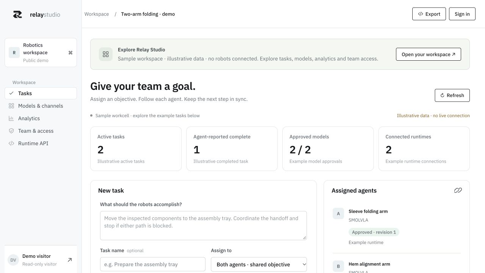
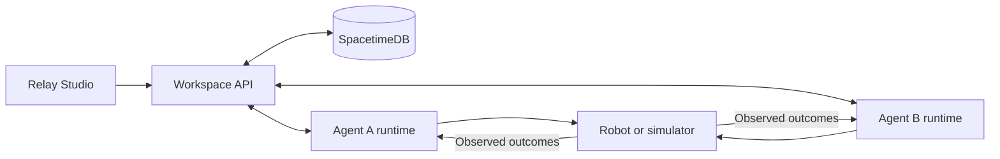

# Relay Lab

**A shared coordination layer for robot teams.**

Relay connects robot agents through a common workspace: assign a goal, share
observations, track execution, and feed outcomes into the next decision.
SpacetimeDB keeps assignments and communication synchronized; each agent's runtime
owns its model inference and actions.

This repository contains **Relay Studio**, the dashboard and worker API, alongside
our **MuJoCo research environments** for testing communication between robot policies.

[Explore the demo](https://relay-studio-dprv.onrender.com/?demo=1#tasks) ·
[Run locally](#run-locally) ·
[Connect an agent](docs/studio-agents.md) ·
[Research results](#experiments-and-evidence)



*Current Relay Studio interface, captured from the public demo. Its example tasks
and metrics are illustrative; measured experiment evidence is linked below.*

## What you can do

- **Coordinate a team.** Assign objectives and success criteria to approved agents,
  then follow their progress and peer feedback.
- **Control model access.** Managers register, release and retire model revisions;
  employees use approved configurations and request changes.
- **Inspect communication.** Compare structured reports, Qwen mediation, learned
  latent messages and hybrid channels in the supported research workflows.
- **Monitor execution.** View packet history, timing coverage, task activity and
  alerts for disconnected workers or overdue work.

Registering weights or an endpoint does not load a model or enable hardware.
Customer runtimes implement the robot-specific handler. Their completion reports
are distinct from independently measured simulator results.

## How it fits together



SpacetimeDB stores ordered task and message state. Live subscriptions deliver
updates, while scheduled reducers check deadlines and run maintenance. The
application applies workspace permissions before forwarding updates to clients.
See the [coordination contract](docs/coordination.md).

Qwen supplies mediation and phase review in the local research workflows. Learned
communication uses trained adapters between compatible model features. The generic
customer worker exchanges structured reports; its handler decides how those reports
enter the next model call.

## Repository contents

This repository contains the dashboard, backend, simulation environments, model
adapters and recorded evidence for research and shared application development.

The standalone package excludes training code, model weights, datasets and
simulation runtimes. Shared changes follow the [repository synchronization guide](docs/studio-sync.md).
Customer state and credentials stay outside source control.

## Run locally

Use **Python 3.13**, **uv**, and **Node.js 22+**. The Python package supports 3.12+;
3.13 is the documented research setup. Local Qwen inference additionally requires
Apple Silicon and the separate MLX environment in the
[research quick start](docs/research-quickstart.md).

### Explore a recorded experiment

```bash
git clone https://github.com/g4nesh/relay-lab.git
cd relay-lab
uv sync --python 3.13 --extra learned --extra deploy
uv run --extra learned --extra deploy relay-lab cloth
```

Open **http://127.0.0.1:8769/** for the bundled cloth recordings and comparisons.
Replay does not require SpacetimeDB or foundation-model downloads.

### Start the dashboard

The local bootstrap installs **SpacetimeDB 2.13.0** inside the repository. It is
verified on macOS arm64; other platforms need the pinned CLI as described in the
[backend guide](docs/spacetime.md). Run these commands from the repository root:

```bash
npm --prefix subscriptions ci
npm --prefix subscriptions run build
python3 scripts/spacetime.py install
python3 scripts/spacetime.py start
```

Keep the database terminal open. In a second terminal:

```bash
python3 scripts/spacetime.py publish
python3 scripts/spacetime.py status
uv run --extra learned --extra deploy relay-lab studio --port 8770
```

Open **http://127.0.0.1:8770/**. Use the local account switcher to explore manager
and employee roles. Qwen-backed exchanges and new simulation runs need the
[additional research setup](docs/research-quickstart.md). To serve the product
website with Studio, follow the [website workspace guide](docs/website-workspace.md).

### Deploy a private workspace

Use the standalone [Relay Studio repository](https://github.com/g4nesh/relay-studio)
and choose either [Render with Spacetime storage](docs/render-free.md) or
[Docker with persistent storage](docs/studio-deployment.md). Each deployment
supports one private customer workspace and one application replica. Hosted
workspaces use authenticated accounts and scoped outbound agent connections.

## Experiments and evidence

These are small simulation studies. Each row links to its protocol and artifacts;
results from different controllers and execution modes are kept separate.

| Experiment | Recorded result | Scope |
| --- | --- | --- |
| [Dashboard-to-simulator task](docs/studio.md#complete-a-local-two-arm-simulation-task) | A fold completed in 1,126 physics ticks; command replay reproduced the final geometry | One fixed seed, task-trained CNN/attention controllers, Qwen and SpacetimeDB |
| [Learned SmolVLA ↔ X-VLA messages](examples/cloth-coordination/learned-latent/README.md) | Hidden-peer hold accuracy: **100% with learned messages, 50% without** | One held-out episode, 20 physical states; frozen backbone features and replacement action heads |
| [Shared receiver experiment](examples/cloth-coordination/shared-latent/README.md) | Other-arm encoder transfer: **96.8% vs 48%** for pairwise adapters | Five training seeds, two model families and two cameras |
| [Factory communication](examples/factory-communication/README.md) | Text and embeddings each completed **12/12 tasks**, versus **2/12** without communication | Controlled comparison with a deterministic scheduler and in-memory coordination |

Structured text matched the successful communication conditions and used smaller
payloads. The experiments do not establish that learned embeddings outperform text.
With delayed and dropped messages, learned-adapter hold accuracy fell to **66.3%**,
versus **66.7%** without communication. Its live control probe made no grasps or
folds. Improving robustness to stale information and completing held-out folds
remain open work.

The working cloth baseline uses state assistance, marked grasp tabs and a
stabilizing fixture. It is not calibrated garment physics or a foundation-VLA
folding result. Native two-SmolVLA adaptation is tracked separately on the
[development branch](https://github.com/g4nesh/relay-lab/blob/codex/customer-workspaces/docs/native-vla-cloth.md).

## Stack and source map

| Layer | Technologies | Source |
| --- | --- | --- |
| Dashboard | JavaScript, HTML, CSS | [`src/relay_lab/studio/web/`](src/relay_lab/studio/web/) |
| Workspace API and workers | Python, ASGI, Uvicorn | [`src/relay_lab/studio/`](src/relay_lab/studio/) |
| Coordination | SpacetimeDB, TypeScript, Node SDK subscriptions | [`spacetimedb/`](spacetimedb/), [`subscriptions/`](subscriptions/) |
| Simulation and learning | MuJoCo, PyTorch, LeRobot, SmolVLA, X-VLA | [`src/relay_lab/cloth/`](src/relay_lab/cloth/), [`src/relay_lab/smolvla.py`](src/relay_lab/smolvla.py) |
| Local language model | Qwen3-1.7B, MLX | [`src/relay_lab/llm.py`](src/relay_lab/llm.py) |
| Deployment | Docker, Compose, Render | [`deploy/`](deploy/), [`render.yaml`](render.yaml) |

## Guides

- [Agent integration and task protocol](docs/studio-agents.md)
- [Studio roles, model releases and communication modes](docs/studio.md)
- [Analytics definitions and evidence](docs/studio-analytics.md)
- [Research setup and experiment commands](docs/research-quickstart.md)
- [Cloth environment and evaluation protocol](docs/cloth-coordination.md)
- [Learned adapter design and related work](docs/latent-coordination.md)
- [Original parcel workcell](examples/demo/README.md)

## Development

```bash
uv run --extra learned --extra deploy pytest
uv run --extra learned --extra deploy ruff check src tests
node --test tests/web/*.test.cjs
npm --prefix subscriptions run check
npm --prefix subscriptions test
```

Live database checks require a disposable database and explicit opt-in; follow
the [backend](docs/spacetime.md) and [coordination](docs/coordination.md) guides.
Keep credentials, downloaded model caches and new run artifacts out of Git.
