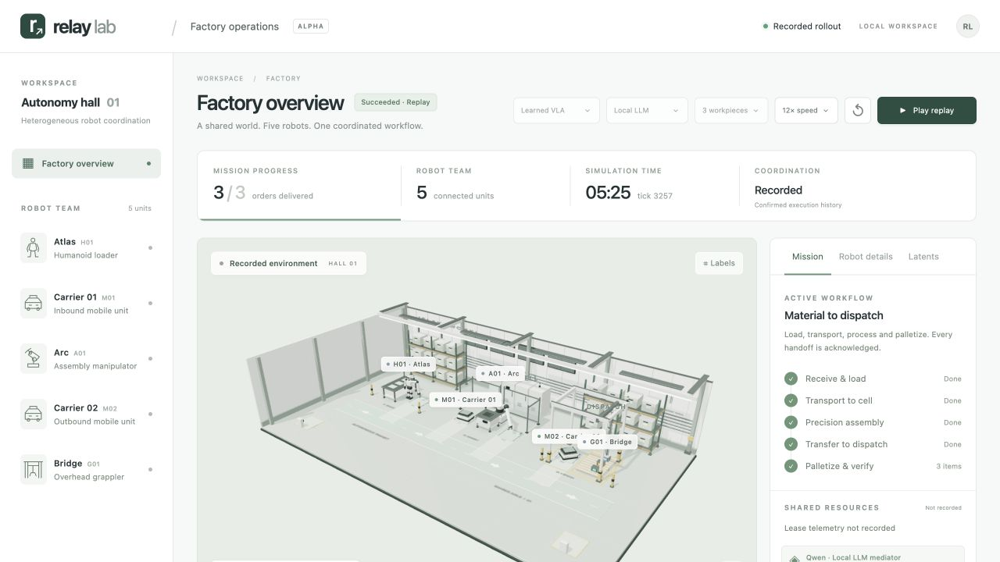
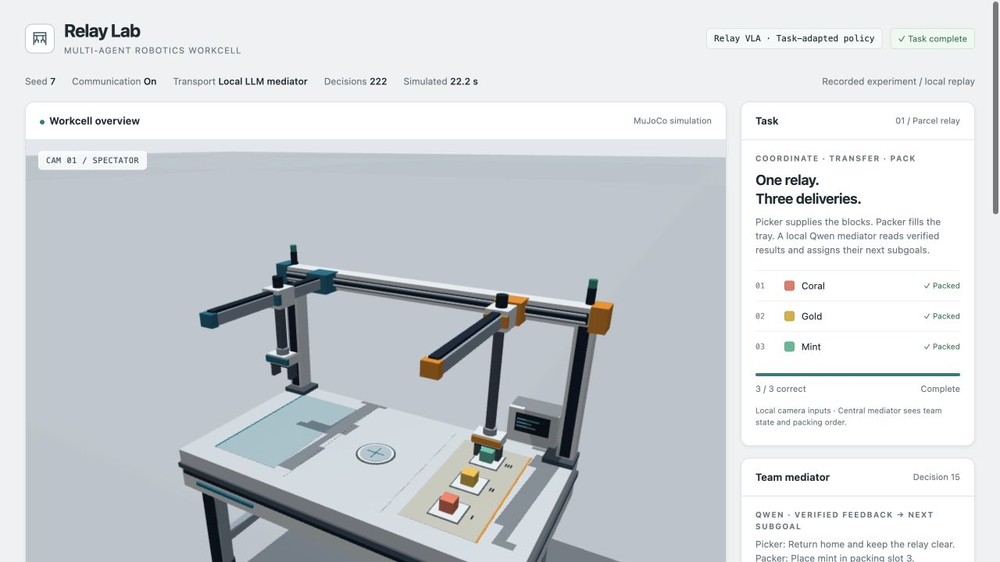

# Relay Lab

An original multi-robot simulation project with a five-robot pilot factory and
a learned-VLA tabletop workcell. Both use local language-model coordination and
SpacetimeDB synchronization.

## Factory dashboard

The new [factory extension](docs/factory.md) combines a humanoid loader, two mobile
carriers, an articulated assembly arm, and an overhead grappler in a continuous
production workflow. Its live 3D dashboard shows robot motion, resource leases,
job progress, and acknowledged handoffs. After the setup below, run:

```bash
python3 scripts/spacetime.py publish
uv run --extra learned relay-lab factory
```

Open <http://127.0.0.1:8767>. Qwen chooses macro skills; all five factory robots
use an original compact RGB/language/action network for motor and gripper output.
A shared learned 32D embedding space carries fresh peer state through SpacetimeDB
back into learned action inference. The dashboard exposes actual sensor images,
latent records, model provenance and measured retrieval timings.

See [Factory VLA and embedding exchange](docs/factory-vla.md) for the calibrated
camera assumptions, training and limits. `--policy model-based` retains the earlier
motion reference explicitly. The [earlier factory recording](examples/factory/README.md)
uses that reference; it is not evidence of the new learned controller.

The [verified learned factory recording](examples/factory-vla/README.md) completes
3/3 workpieces with 4,390 neural actions and 338 peer-fusion actions. All 3,257
commits match SpacetimeDB. A six-workpiece learned run also completes. That version
passed 379 tests, including real database failure checks. Its fully observed pose
embedding comparison shows actual use, but no demonstrated performance benefit.



## Partial-observation communication experiment

The new `dispatch-routing` task makes communication decision-relevant: only the
receiving humanoid sees a private inspection cue, while the gantry needs it to
select the correct pallet slot. Other robots see only nearby dynamic objects.
Qwen schedules public skills; Spacetime commits job-scoped learned beliefs.

Compare **embeddings, exact text, and no private communication** using matched
seeds, images, frozen motor weights and budgets. Text and vectors carry the same
learned visual prediction, so text is a strong baseline. Physical delivery and
correct sorting are scored separately. See the [task and information boundaries](docs/factory-communication.md)
and [recorded comparison](examples/factory-communication/README.md).

The controlled comparison completed **12/12 tasks with either embeddings or
text, versus 2/12 without private communication**. Text matched the result with
smaller payloads. A separate real Qwen/Spacetime suite preserves one interrupted
database run in its results; it is not pooled with the controlled comparison.
The current project has 480 passing tests across the full regression and final
server checks.

```bash
uv run --extra learned relay-lab factory-run \
  --task dispatch-routing --communication embeddings --seed 101 --orders 3 \
  --output runs/private-dispatch
```

## Original learned-VLA workcell

One robot supplies colored parcels through a shared relay pad; the other packs
them in a requested order.

The active loop uses **a local Qwen LLM mediator, a small task-adapted learned
vision/language/action policy, a deterministic outcome judge, and SpacetimeDB**.
Fetch has been removed from the runtime. Its previous integration is preserved
under `legacy/fetch/`; no Fetch account, credential, SDK, or network is needed.

```text
Task + assignments in SpacetimeDB
             ↓
Qwen reads team observations + verified action feedback
             ↓
Validated pick / place / wait instructions, committed to SpacetimeDB
             ↓
Two separate Relay VLA policy contexts → neural motor actions
             ↓
Spacetime action barrier → one simultaneous MuJoCo step
             ↓
Observed motion, grasp, release, packing → deterministic text judge
             ↓
Atomic feedback commit → next motor step or event-driven LLM decision
```

The LLM chooses semantic subgoals. It runs at meaningful state changes and
sustained stalls, not every motor tick. The judge reports observed outcomes
without another model call. Invalid LLM output gets one bounded correction;
there is no scripted planner fallback. Database failure stops the rollout.

## Included working example



The repository includes the small trained controller, our original 400-scene
simulator dataset, and a [complete recorded demo](examples/demo/README.md)
with video, replay and decision logs. [Validation evidence](examples/validation.json)
records four successful end-to-end runs across three held-out seeds.

## Run locally

The local LLM runtime is for Apple Silicon. Tested on an M3 Pro with 18 GB RAM.
Python 3.13, `uv`, Node.js 22+ and npm are required. Clone your private repo first:

```bash
git clone https://github.com/g4nesh/relay-lab.git
cd relay-lab
```

Run the following commands from that repository root.

```bash
uv sync --python 3.13 --extra learned
uv venv --python 3.13 .venv-llm
uv pip install --python .venv-llm/bin/python -r requirements-llm.txt

python3 scripts/spacetime.py install
python3 scripts/spacetime.py start
```

Keep that terminal running. In a second terminal:

```bash
python3 scripts/spacetime.py publish
python3 scripts/spacetime.py status

# Optional: regenerate the included reference data and retrain the policy:
uv run --extra learned python -m relay_lab.train_relay_vla collect --scenes 400
uv run --extra learned python -m relay_lab.train_relay_vla train --pixel-steps 1500 --control-steps 10000

# Defaults: local LLM mediator, Relay VLA, SpacetimeDB, real video.
uv run --extra learned relay-lab run --seed 7 --output runs/local-mediator
uv run --extra learned relay-lab serve --directory runs --port 8766
```

Open `http://127.0.0.1:8766/local-mediator/replay.html` after the rollout.
The pinned Qwen checkpoint downloads on first use (subsequent inference is
local). Missing weights or runtime dependencies produce an error; they never
silently select a scripted policy.

Useful explicit alternatives:

```bash
# Isolate mediator quality with an explicitly scripted action controller.
uv run --extra learned relay-lab run --policy scripted --planner llm --no-video

# Lightweight rules + scripted reference; no LLM or database required.
uv run relay-lab run --policy scripted --planner rules --coordination memory --no-video

# Original, unadapted foundation VLA remains an experimental comparison.
uv sync --extra learned --extra vla
uv run --extra learned --extra vla relay-lab run --policy smolvla --device mps

# Inspect an authoritative task record.
uv run relay-lab task-status TASK_ID
```

`--order gold coral mint` sets the order; `--checkpoint PATH` selects an adapted
policy; `--llm-python PATH` selects the isolated MLX interpreter.
`--planner rules --comm off` is the private-order communication ablation.
The centralized mediator requires communication and sees the whole task order;
it is not equivalent to that decentralized ablation.

## Models and boundaries

- **Mediator:** official `Qwen/Qwen3-1.7B-MLX-4bit`, pinned to revision
  `21457c6f51ed54a7c16e988c0844db973815c137`, greedy generation in a persistent
  local MLX worker. No cloud API. It receives bounded structured observations,
  observed execution events, and feedback. It does not receive raw camera frames.
- **Relay VLA:** a compact, task-specific neural policy trained on original
  simulator examples. It learns image localization, constrained language routing,
  and Cartesian motor/gripper output. Runtime inputs are local RGB, robot
  proprioception, and instruction text; object poses and scripted control are
  excluded from learned inference. This is **not fine-tuned SmolVLA** and is not
  a general-purpose pretrained VLA.
- **SmolVLA:** the pinned LIBERO checkpoint remains available. It has not learned
  this scene/embodiment; earlier full runs failed to pack any parcels. Fixing
  replanning alone does not repair that domain mismatch.
- **Judge:** deterministic interpretation of actual before/after simulator state.
  A raw proposed action is never evidence that a grasp or delivery succeeded.
  Minor clipping is factual feedback; attachment changes, new failures, and
  sustained stalls can request replanning. Repeated clipping is debounced.

This is a deliberately small learned-control prototype. Cameras, colors,
workspace geometry and language vocabulary are constrained. Physics uses
Cartesian grippers and proximity attachments, not contact-rich grasp learning.
The task and data are ours; this is not RoboPoly evaluation or a novelty claim.

## Verified end-to-end results

Actual local Qwen + learned Relay VLA + MuJoCo + SpacetimeDB, with no scripted
fallback, completed all three held-out seeds on October 24, 2026:

| Seed | Order | Outcome | Steps |
| --- | --- | --- | --- |
| 7 | coral → gold → mint | 3/3 | 222 |
| 42 | gold → mint → coral | 3/3 | 224 |
| 101 | mint → coral → gold | 3/3 | 224 |

The final default-command repeat is in `runs/mediator-final/`: 30.062 seconds
wall time including video, 15 Qwen generations averaging 0.870 seconds, and
444 neural robot actions. This is a small functional check, not a benchmark.
The database audit in `runs/mediator-validation.json` checked all four runs:
every plan, action and report matches its local log; each task is durably
`succeeded`. **231 tests passed**, including live Spacetime concurrency and
failure checks. Ruff and package builds passed.

## Inspect the loop

Each run saves:

| File | Evidence |
| --- | --- |
| `replay.html`, `rollout.mp4` | Synchronized scene, instructions and outcomes |
| `mediator.jsonl` | Actual LLM prompts, outputs, reasons, triggers and latency |
| `steps.jsonl` | Each local observation, instruction, neural prediction and executed action |
| `action-feedback.jsonl` | Grounded action-to-text reports used next tick |
| `execution.jsonl` | Verified grasp, handoff, completion and failure events |
| `model.json` | Model/checkpoint provenance, training metadata and inference counters |
| `coordination.json` | Database, task and worker IDs |
| `summary.json` | Actual task outcome and measured timing |

Spacetime stores both plans, both action proposals and both observed reports
behind ordered barriers for every tick. It does not execute physics or model
inference, and a database restart does not resume the simulator. See
[the backend contract](docs/spacetime.md), [learned policy](docs/relay-vla.md),
and [policy interface](docs/policy-interface.md).

## Development

```bash
uv run --extra learned pytest
uv run --extra learned ruff check src tests
RELAY_SPACETIME_INTEGRATION=1 uv run --extra learned pytest tests/test_spacetime.py
RELAY_SPACETIME_LIVE_URL=http://127.0.0.1:3000 \
RELAY_SPACETIME_LIVE_DATABASE=relay-lab \
RELAY_SPACETIME_LIVE_TOKEN_FILE="$PWD/.relay-lab/spacetime-token" \
  uv run --extra learned pytest tests/test_spacetime_live.py
```

Credentials, environments, downloaded model caches and new generated runs are
ignored by Git. Only the small reference checkpoint and original simulator
dataset are included; other training outputs remain ignored. The archived Fetch sources are excluded from the
installed package and active test suite.
