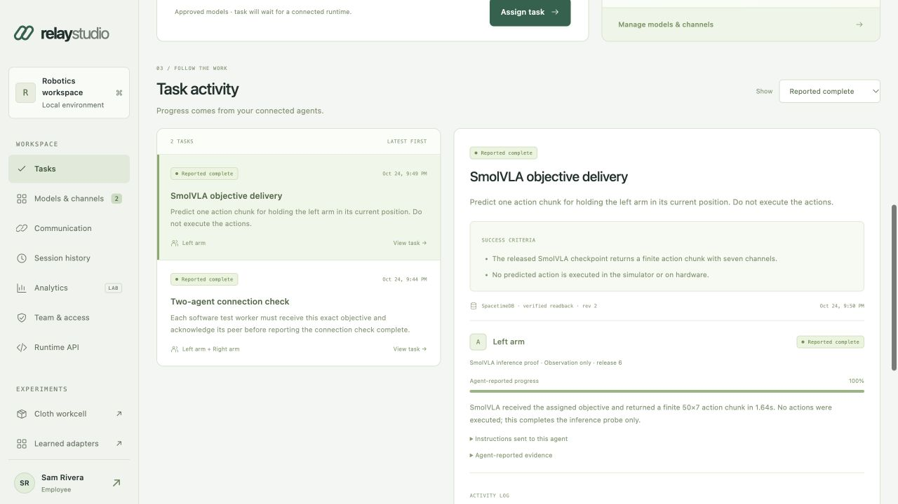

# Assign objectives to your agents

Studio's **Tasks** view sends a customer objective to the selected agent runtime,
records progress in SpacetimeDB, and returns peer feedback to the next handler
step. It uses the existing two-model workspace and manager approvals. A task is
separate from the workspace's saved communication objective: creating a task does
not overwrite that configuration.

For a private HTTPS installation, follow the [deployment guide](studio-deployment.md).
For local startup and model releases, see the [Studio guide](studio.md).

## From a goal to a reported outcome

1. A manager registers both models under **Models & channels**, saves the workspace,
   and releases both exact configurations. The current workspace remains a pair;
   even a task assigned to one agent requires that approved pair.
2. Under **Tasks → Runtime connections**, the manager creates a connection for
   agent A or B, selecting **Observation only** or **Simulation**. Save the one-time
   credential as `worker-token` on the agent host. Your own runtime loads the model;
   Studio does not discover robots or contact arbitrary model/rig endpoints.
3. Start the outbound worker on that host. A recent authenticated heartbeat makes
   the connection show **Connected**. This indicates API connectivity, not a live
   camera, working model, or verified robot readiness.
4. Any signed-in workspace member can enter an objective, optional task name,
   success criteria, and a target of A, B, or both. The task can queue before its
   runtime connects. Its title is limited to 100 characters, its objective to
   2,000, and its criteria to 1–8 lines of at most 500 characters each.
5. An eligible worker claims its assignment. Its local handler receives the exact
   objective, criteria, model release, and current peer reports. It returns an
   observed outcome. Subsequent steps read the latest shared state before calling
   the handler again.
6. Inspect per-agent progress, instructions, evidence, and the activity log.
   **Reported complete** means every assigned agent reported success. Studio does
   not independently attest to a grasp, fold, manufacturing result, or physical
   action.

The task's state, assignments, command/report messages, revision, request receipts,
and model-release snapshot live in the existing private SpacetimeDB factory
coordinator. An update is exposed after its committed state is read back and
verified. Manager/employee identities, model approvals, and hashed worker credentials
remain in the private workspace's local SQLite stores. Back up both the app state
and the Spacetime database.

The generic outbound goal loop exchanges **structured text feedback**. Its stored
communication profile records the saved workspace mode, but does not automatically
invoke Qwen, the learned latent adapters, or a VLA. A customer's handler must
explicitly integrate its desired inference and peer-context path. The existing
communication console supports its separate learned and language probes.

For a complete bundled task, the local **Two-arm simulation** recipe integrates
two original task-trained controllers, actual Qwen phase review, MuJoCo execution,
and Spacetime coordination. A team runtime owns both controller contexts in one
shared world and reports through the same task APIs. Managers explicitly prepare
and approve the exact model pair before launching. Read the
[simulation workflow](studio.md#complete-a-local-two-arm-simulation-task) for
prerequisites, cancellation, recordings and measured-outcome limits. This recipe
is distinct from the SmolVLA inference-only probe below and does not establish
universal latent compatibility or automatic robot discovery.

## Run the outbound worker

The bridge supports Python 3.12+ on macOS and Linux. Its module uses Python's
standard library, including POSIX file permissions and file locking. It has no
Torch, MLX, or MuJoCo requirement unless your handler imports those libraries.
Install this checkout in an environment appropriate for your model. For a bridge
that only needs the standard-library observation example below:

```bash
python3 -m venv /path/to/agent-env
/path/to/agent-env/bin/python -m pip install --no-deps /path/to/relay-lab
```

Move the downloaded token file from your browser's Downloads folder to a private
runtime directory. Keep it out of source control. Run from the directory containing
your locally installed handler module:

```bash
chmod 600 ./worker-token
/path/to/agent-env/bin/python -m relay_lab.studio.worker \
  --url https://YOUR-WORKSPACE-DOMAIN \
  --token-file ./worker-token \
  --handler readiness_agent:handle \
  --state-dir ./agent-state
```

For local development, replace the origin with `http://127.0.0.1:8770`. Remote
origins require HTTPS. Tokens never belong in URLs, shell arguments, screenshots,
or logs. The reader rejects symlink token files, files owned by another user, and
files readable by other users. The client refuses redirects.

`--state-dir` must be persistent and private. The worker creates a separate
journal directory per credential and takes a process lock to prevent two local
workers sharing that journal. Use **one credential and its durable journal on one
agent host**. Do not copy a credential to multiple machines or run it with separate
state directories: there is no distributed runtime-instance fence, and the local
file lock does not coordinate different hosts. Revoke the old connection before
creating a new one for a replacement host. Preserve the directory across restarts; do not use
a disposable container layer for it. Polling defaults to three seconds and accepts
`--interval 1` through `--interval 60`. `--once` processes one inbox pass; it does
not wait for a complete multi-step task. A separate heartbeat runs every ten
seconds. The UI considers a heartbeat recent for 45 seconds.

## A minimal observation handler

Save this as `readiness_agent.py` beside the command's working directory. It only
acknowledges one specifically named observation task. It does not infer or execute
robot actions:

```python
EXPECTED_OBJECTIVE = "Confirm this observation worker can receive an assigned objective."


def handle(context):
    task = context["task"]
    if context["should_stop"]():
        return {
            "status": "blocked",
            "progress": 0,
            "summary": "Fresh authorization or task state is unavailable; holding.",
            "evidence": [],
        }
    if task["objective"] != EXPECTED_OBJECTIVE:
        return {
            "status": "blocked",
            "progress": 0,
            "summary": "This observation handler only supports its explicit receipt check.",
            "evidence": [],
        }
    return {
        "status": "succeeded",
        "progress": 100,
        "summary": "The assigned objective reached this observation worker unchanged.",
        "evidence": [
            "Objective matched the handler's exact receipt-check instruction.",
            "No policy inference or robot action was performed.",
        ],
    }
```

Create a single-agent task with that exact objective and the success criterion
“The observation handler receives the exact assigned objective.” This checks the
real assignment/report path; its success says nothing about a manipulation task.

For a real adapter, replace this handler with code that reads local observations,
prepares model inputs, generates an action, validates it against the rig's limits,
executes it in your simulator, and reports the observed result. Keep long-running
steps cooperative: call `context["should_stop"]()` before action and while waiting.
The bridge cannot forcibly interrupt arbitrary customer code or physically stop a
robot. Local interlocks and hardware emergency stops remain the runtime's job.

## A real VLA inference probe

The bundled `relay_lab.studio.probe_agent:handle` runs a fresh, observation-only
SmolVLA action prediction. It requires the repository's `vla` dependencies, the
pinned public checkpoint, and a functioning local MuJoCo renderer on the agent
host. It is not included in the small hosted dashboard container.

Use the released **left** model
`HuggingFaceVLA/smolvla_libero@6721902bc4d61e50a3bfdb11dfb4cb626f05d102`
and create an **Observation only** connection. Assign only that agent this exact
objective:

> Predict one action chunk for holding the left arm in its current position. Do not execute the actions.

Enter these two success criteria, in this order:

1. The released SmolVLA checkpoint returns a finite action chunk with seven channels.
2. No predicted action is executed in the simulator or on hardware.

From the repository root on the agent host:

```bash
uv sync --extra vla
chmod 600 /private/path/worker-token
RELAY_AGENT_EVIDENCE_DIR=.relay-lab/agent-evidence \
uv run --extra vla python -m relay_lab.studio.worker \
  --url http://127.0.0.1:8770 \
  --token-file /private/path/worker-token \
  --handler relay_lab.studio.probe_agent:handle \
  --state-dir .relay-lab/agent-state \
  --once
```

The adapter refuses other objectives, criteria, model sources, or execution kinds.
It creates fresh local front/wrist camera observations and proprioception, supplies
the assigned objective to the pinned VLA, checks the returned action chunk, and
saves a local JSON evidence artifact with model identity, action values, timing,
and prompt. The dashboard receives a summary and artifact hash. The simulator
remains at tick zero and no predicted action is executed. **Reported complete**
therefore means the inference probe completed; it is not a completed holding or
manipulation task. Model inference can be slow on a CPU; `RELAY_AGENT_DEVICE`
accepts `auto`, `cpu`, `mps`, or `cuda` when the installed runtime supports it.

## Handler contract

The bridge calls a locally installed `module:function` with this dictionary:

| Key | Meaning |
| --- | --- |
| `task` | Latest task state, including `objective`, `success_criteria`, `assignments`, `revision`, and recent events |
| `worker` | Scoped worker identity, agent slot, approved model/revision, and declared execution kind |
| `step` | Zero-based local handler invocation count for this task |
| `should_stop` | Callable returning true on cancellation/terminal state, lost authorization, heartbeat failure, or unavailable fresh state |

Your own assignment is `task["assignments"][worker["agent_id"]]`. Other entries
contain each peer's latest status, progress, summary, and evidence. Treat peer
reports as input to your controller; they are not independently verified sensor
observations. Only the credential owning an assignment may update it.

Return a dictionary with:

| Key | Allowed value |
| --- | --- |
| `status` | `running`, `blocked`, `succeeded`, or `failed` |
| `progress` | Finite percentage from 0 to 100; success requires exactly 100 |
| `summary` | 1–1,000 characters describing what actually happened |
| `evidence` | Optional list of at most 8 text items, each 1–500 characters |

A `running` result allows another step on the next inbox pass. A normal `blocked`
result pauses until the task revision changes, such as when a peer supplies new
feedback. This prevents repeated replanning against an unchanged blocked state.
A handler exception, uncertain interrupted execution, or local step-budget limit
creates a persistent hold that requires operator review and a new objective.

The task is `queued` initially, `running` after an assignment is claimed, and
`blocked` if an agent reports a blockage. It becomes `succeeded` only when all
assigned agents succeed. A failed assignment fails the task; cancellation is
terminal. Other agents must observe terminal state and stop their own work.



## Scheduled runs and deadlines

In the New task form, **Start** can be "At a set time", **Repeat** can run the
same objective every 5, 15 or 30 minutes, hourly, every 6 hours or daily (2–20
runs), and **Deadline** arms a watchdog (5 minutes to 24 hours) on each task.

SpacetimeDB owns the clock. Each run is a timer row in a scheduled table; when it
is due, the database fires the `fire_task_schedule` reducer, even if Studio is
closed. That reducer only records a due dispatch and chains the next timer. Studio's
background pump (every 5 seconds) then re-checks the creator's account and the
current model releases, creates the task through the normal path with the dispatch
key as its `request_id`, and records the outcome as **Task created** or **Blocked**
with the reason. A run that fires while the previous one is still waiting is
recorded as **Skipped** instead of queuing twice. If Studio was offline for several
intervals, missed slots are skipped and the next run is one interval from now.

A deadline timer fires `check_task_deadline`, which reads the task's journal at the
deadline and records **met** (finished in time) or **missed**. Missed deadlines on
open tasks appear under **Needs attention**. Scheduled reducers reject any caller
other than the database's own scheduler, and none of them write the task journal.

Cancel an active schedule to delete its pending timer; remove a finished schedule
to delete its records. Tasks a schedule created always stay in task history.
Scheduling needs the module published from this branch (`python3 scripts/spacetime.py publish`);
until then the Scheduled runs panel explains that it is unavailable.

## Retry, cancellation, and release changes

Task creation uses an idempotency `request_id`. Claims, reports, and cancellation
also carry the expected task revision; conflicting or stale proposals are rejected.
The SDK saves an action's pending report before sending it. On a network retry it
resends that report or reconciles its request receipt instead of repeating the
handler's action.

Before invoking customer code, the worker fsyncs an `executing` journal entry.
If it crashes during that step, it cannot know whether a physical action occurred.
On restart it reports a blocked outcome and holds that task. It does **not**
automatically retry the action, transfer the claim, or reset its journal. Inspect
the runtime, cancel the old task, then create an appropriate new objective. The
same applies if a claimed task's local journal is lost.

**Cancel task** records a cancellation and its reason. Employees can cancel only
tasks they created; managers can cancel any task in the workspace. This is cooperative
cancellation, not an emergency stop. If a response times out, inspect the recorded
task and retry the original request identity; a timeout does not prove that no
commit occurred. `pending_update` indicates an update whose completion needs
reconciliation. State readback is not a guarantee of exactly-once physical motion
or equal crash durability across database releases.

Worker credentials expire after 30 days. They are bound to one registry identity,
agent slot, model ID, and approval revision. Explicit revocation, issuer account
deactivation/demotion, model retirement, or a changed approval blocks further
worker access. Releasing a model again requires a new connection and a fresh task;
it does not revive the old pin. Employees can inspect connection status but cannot
create or revoke credentials. The declared runtime kind describes its intended
use; it is not a sandbox around locally installed customer code.

The current installation has explicit limits: 32 active unexpired worker
credentials, 100 stored tasks per workspace, up to 120 update revisions per task,
and 50 handler steps per agent/task. Active task payloads have a 48 KiB byte budget,
with another 16 KiB reserved for cancellation. The byte budget can be reached
before the revision limit. Task state retains up to 16 recent display events and
the UI shows up to 12; older display events may be dropped to fit the budget,
while request receipts remain available for retry reconciliation.

An oversized report is rejected with HTTP 400 before the update is prepared.
The SDK retains the already-computed pending result and does not execute the
handler again. Review the adapter's report/evidence size or cancel the task;
do not delete its journal to force another action. At the task-history capacity,
new creation is rejected rather than silently dropping history; archive/export
the deployment and provision a new workspace registry. These bounds make this a
small-team installation, not an unbounded factory scheduler.

## APIs

Browser routes require the normal authenticated session cookie. POST mutations
also require the session's `X-Relay-Token` CSRF value. Worker routes instead use
`Authorization: Bearer <scoped-worker-token>` and never inherit browser-manager
permissions.

| Route | Purpose |
| --- | --- |
| `GET /api/tasks` | Current workspace's task history |
| `POST /api/tasks` | Queue `{request_id, objective, success_criteria, target, title?, deadline_minutes?}` |
| `GET /api/tasks/{goal-id}` | Read one task and its recorded outcome |
| `POST /api/tasks/{goal-id}/cancel` | Cancel with `{request_id, expected_revision, reason}` |
| `GET /api/schedules` | Schedules, their runs, and task deadlines |
| `POST /api/schedules` | Schedule `{request_id, objective, success_criteria, target, title?, start_at, repeat_minutes, max_runs, deadline_minutes?}` |
| `POST /api/schedules/{sched-id}/cancel` | Cancel an active schedule with `{reason?}` |
| `POST /api/schedules/{sched-id}/remove` | Delete a finished schedule's records |
| `GET /api/workers` | Scoped connection metadata; never returns existing tokens |
| `POST /api/workers` | Manager creates `{name, agent_id, execution_kind}` and receives the token once |
| `POST /api/workers/{worker-id}/revoke` | Manager revokes that connection |
| `GET /api/agent/me` | Authenticate the worker and inspect its scope |
| `POST /api/agent/heartbeat` | Update presence with `{controller_label}` |
| `GET /api/agent/tasks` | Assigned tasks eligible for this worker's exact release |
| `GET /api/agent/tasks/{goal-id}` | Read assigned task and this worker's request receipts |
| `POST /api/agent/tasks/{goal-id}/claim` | Claim with `{request_id, expected_revision}` |
| `POST /api/agent/tasks/{goal-id}/report` | Send the outcome contract plus `{request_id, expected_revision}` |

Use the provided SDK unless you need a different language/runtime. An alternative
client must preserve operation identities, verify revisions, retain a durable
execution journal, obey authorization/cancellation failures, and avoid blindly
replaying actions after an ambiguous result.
