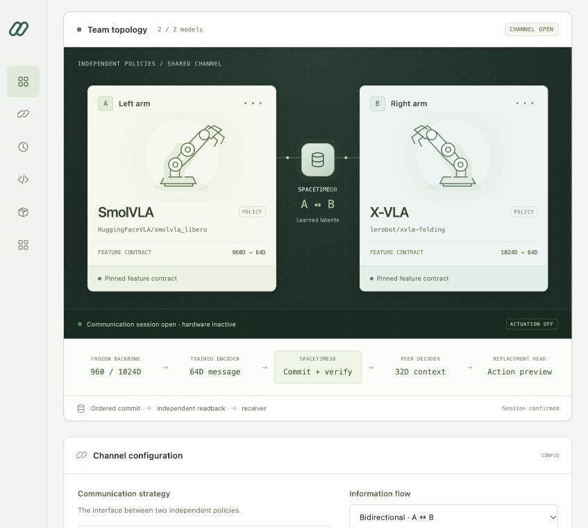
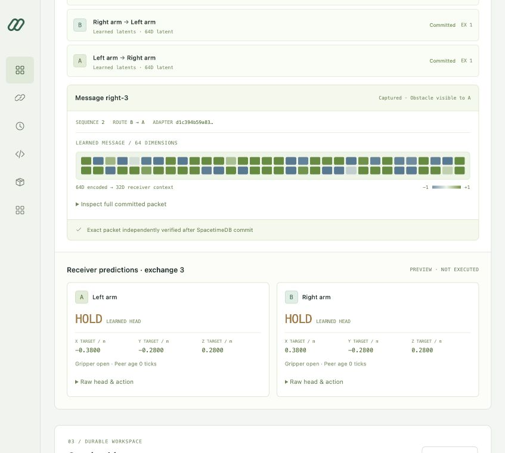

# Relay Studio: two-model coordination workspace

Relay Studio registers two robot-model workers, checks their compatibility, and
runs inspectable communication exchanges through the existing **SpacetimeDB
factory coordinator**. The learned path uses the repository's trained
**CoLA-inspired SmolVLA/X-VLA adapters**. Text paths use the pinned local Qwen model.
Robot coordination keeps the existing Spacetime schema. Dashboard identities,
model approvals and change requests use private local SQLite stores; the
simulation runners remain separate.

The default **Tasks** view turns an objective into a durable assignment for an
approved agent or pair. A scoped outbound runtime receives that exact goal,
reports outcomes, and reads peer feedback. See the [customer task and SDK guide](studio-agents.md)
for its handler contract, limits, and distinction from the communication probes.
For a customer installation, use the [private HTTPS deployment package](studio-deployment.md).

## Start and check the backend

From the repository root, with the existing Spacetime service running:

```bash
uv run --extra learned relay-lab studio --port 8770
```

Open <http://127.0.0.1:8770/>. The README describes Spacetime setup and the isolated
`.venv-llm` runtime. Qwen3-1.7B MLX runs locally on Apple Silicon; latent-only
exchanges do not require Qwen. The cloth experiment remains available separately
from the Studio interface.

On first launch, create the initial manager account using the one-time code in
`.relay-lab/studio/setup-code`. The server prints the file's location, never its
contents. Open the file locally and enter the code on the setup screen with your
chosen username and password (12–128 characters). There is no default account or
password. Setup consumes the code. Managers create one-use, 24-hour invitations
under **Team & access**; the invited person chooses their own password.

## Roles and model releases

| Operation | Manager | Employee |
|---|---|---|
| Inspect model configurations, cameras and session history | Yes | Yes |
| View aggregate analytics and calculate effort scenarios | Yes | Yes |
| Run the saved workspace using released models | Yes | Yes |
| Assign objectives and inspect agent-reported outcomes | Yes | Yes |
| Cancel objectives | Any workspace task | Own tasks only |
| Create/revoke scoped runtime credentials | Yes | No |
| Submit model change requests | Yes | Yes |
| View requests | All | Own requests |
| Add/upload/edit models or change the workspace | Yes | No |
| Release or retire a model revision | Yes | No |
| Resolve requests, invite members, change roles, view the audit log | Yes | No |

Saving a previously unseen model configuration registers a **draft**. A manager
reviews each exact configuration and explicitly releases it for Studio use.
Changes to its source, revision, embodiment, slot, rig, action contract or name
create a different draft. Hugging Face registrations require a source revision
before release. Approval does not load arbitrary weights, attest to model quality,
deploy a controller, or enable robot actuation. Local paths and endpoints remain
configuration references, not immutable hashes of externally served weights.

Each new Spacetime session stores its registry identity, exact model-release IDs
and approval revisions in `state.model_release`. Approvals from a different or
recreated local registry cannot authorize an older session. The server checks those approvals before
every exchange and resume. **Retirement blocks subsequent exchanges**, including
existing sessions. Releasing that configuration again creates a new approval
revision; start a fresh session rather than reviving the old approval. Earlier
sessions without release snapshots remain inspectable but cannot resume.

Employees submit add, edit, release or retire requests. Managers resolve or
decline each request with a recorded response. Marking a request resolved does
not change the model's approval: release remains a separate explicit operation.
Role changes and account deactivation revoke existing sign-ins. The final active
manager cannot be demoted or disabled.

HTTP authorization uses the authenticated account from SQLite, never a role
field in a request. Passwords use salted scrypt hashes; opaque session and
invitation credentials are stored hashed. Sessions expire after eight hours.
Browser credentials use HttpOnly, SameSite=Strict cookies and mutations require
a session-specific CSRF token. Login attempts are throttled. Account, model and
request operations have audit records. This follows the request-level checks in
the [OWASP authorization guidance](https://cheatsheetseries.owasp.org/cheatsheets/Authorization_Cheat_Sheet.html).

The development command runs a **single-server, loopback deployment**. For a
hosted workspace, use the separate [HTTPS deployment entry point](studio-deployment.md),
which retains one process and one private state volume per customer installation.
Trusted Python callers and the OS account owning its private files remain
administrators; dashboard roles do not protect the separate experiment servers or
the host OS. Back up the access, approval, and worker-credential stores with the
workspace and its Spacetime database.

The health panel distinguishes an authenticated database read, verified adapter
artifacts, and the local Qwen interpreter's presence. Interpreter presence is not
a successful generation test: Qwen is exercised when an exchange runs.
Compatibility diagnostics validate the registrations and load the selected
bundled adapter to check its mode and feature contracts.

## Configure and inspect a team

The **Analytics** navigation opens source-backed comparisons and current workspace
metrics. See the [analytics guide](studio-analytics.md) for measurement definitions,
coverage, filtered exports, and the engineering-effort scenario.

1. Register model A and model B with an embodiment, model family, checkpoint
   source, optional rig URL, and action contract. A repository, local path,
   inference endpoint, or uploaded `.safetensors` file can be registered.
2. Choose mediation, orchestration, learned latents, or hybrid, and select the
   delivery direction. Use the pinned example pair for the trained latent path.
3. Save the workspace and have a manager release both model revisions. Check
   compatibility and open a channel. Its workspace, release snapshot and
   communication journal are stored in SpacetimeDB.
4. Send each worker's local report, or select a captured partial-observation
   condition. The two camera previews show the exact stored local images used to
   extract those features.
5. Inspect committed packets, timing, model provenance, and any receiver action
   previews. Previously created protocol-2 sessions can be selected and resumed
   when their database state is consistent and ready.

| Mode | Actual computation | Required worker integration |
|---|---|---|
| LLM mediator | Separate Qwen call for each sender's report produces a peer message | Supply a local report and consume received text |
| LLM orchestrator | Qwen reads both reports and the objective, then assigns individual instructions | Consume the assigned instruction |
| Learned latents | Native features → trained 64D sender message → trained 32D recipient context | Supply compatible frozen features and use the trained receiver |
| Hybrid | Central Qwen instructions, learned messages, and captured structured safety facts travel together | Integrate the text and learned paths explicitly |

Direction controls **delivery**: A → B, B → A, or both. The central orchestrator
still sees both reports. Packet `context_scope` records that distinction. In
orchestrated modes, `sender` identifies the peer channel; Qwen generated its text
from both reports.

## Verified learned-adapter bundle

Studio uses tracked artifacts under
`examples/cloth-coordination/learned-latent/`; it does not require the original
ignored `runs/` directories:

```text
files.json
dataset/{metadata.json,rows.json,rgb.npz}
features/{left,right}.{json,npz}
models/{embeddings.pt,hybrid.pt,evaluation.json}
```

The registry verifies these files against SHA-256 entries in `files.json`, caches
loaded adapters, and invalidates its cache when tracked file metadata changes.
The manifest is an integrity inventory, not a publisher signature. Loading checks
the checkpoint's communication mode, hash, extractor identities, and recorded
training provenance. Captured samples additionally pass the dataset loader's
RGB, observation, feature-cache, and split-alignment checks.

The trained pair is fixed:

| Slot | Frozen source | Revision | Native feature width |
|---|---|---|---:|
| A / left | `HuggingFaceVLA/smolvla_libero` | `6721902bc4d61e50a3bfdb11dfb4cb626f05d102` | 960 |
| B / right | `lerobot/xvla-folding` | `c87d6e8fcf47fb19d6aac8b67d35dd20d74bbc8d` | 1024 |

A different family, checkpoint, revision, source, or embodiment cannot silently
reuse these adapters. Compatibility requires learned translation; normalizing
unrelated vectors does not provide it. See the [learned experiment](latent-coordination.md)
for architecture, training, and recorded evaluation details.

## What the preview establishes

Captured probes reuse held-out images, previously extracted foundation-model
features, local measured state, and a supplied task phase. Adapter inference runs
fresh, and Qwen generation runs fresh in text modes. The camera images are
captured observations, not live camera feeds. Qwen receives a deterministic
local-observation description that distinguishes an unseen obstacle from a
confirmed clear path.

The receiver action head is a **trained replacement**, assisted by local measured
state. It does not use either VLA's native action head and is not a reproduction
of CoLA's published diffusion policy. Its preview uses the committed peer vector
only after exact database readback. Hybrid packets carry precisely the documented
11 safety fields alongside the vector. **The learned head does not consume Qwen
instructions**; those instructions are delivered separately for a worker to
integrate.

Registration stores arbitrary weights inertly and does not execute model
repository code. Uploads are limited to 4 GiB and their file envelope is checked.
Full model loading, tokenizer/preprocessing, native action decoding, and endpoint
integration remain the worker's responsibility. Rig and inference URLs are
configuration references; Studio does not contact them or issue hardware commands.

A successful exchange confirms communication, not a grasp or completed task.
The prior live learned-controller trial missed 12 of 14 required obstacle holds,
with zero grasps and no fold. Fresh-message diagnostic performance does not
establish delay robustness. Studio does not add automatic strategy selection,
universal latent alignment, or an end-to-end folding controller.

## Local bridge API

The interface includes a copyable Python bridge example. The API exchanges a
batch of local worker reports at each step; it does not manage worker processes
or provide an asynchronous hardware driver.

| Route | Purpose |
|---|---|
| `GET /api/auth/status` | Public setup/sign-in status, without bootstrap codes or credentials |
| `POST /api/auth/setup`, `/login`, `/join` | Initial manager setup, sign-in, or invitation acceptance; establish a session cookie |
| `POST /api/auth/logout` | Revoke the current sign-in |
| `GET /api/bootstrap` | Authenticated user, permissions, session CSRF token, workspace, model approvals and capabilities |
| `GET /api/health` | Authenticated Spacetime read status, artifact registry metadata, and Qwen runtime state |
| `POST /api/diagnostics` | Check a complete workspace's registration, database, and selected adapter/runtime requirements |
| `POST /api/workspace` | Manager-only save and draft model registration |
| `GET /api/models` | Exact model configurations, approval revisions and release readiness |
| `POST /api/models/{id}/release`, `/retire` | Manager-only transition with `expected_revision` and optional `reason`; stale approvals return 409 |
| `GET /api/team`, `POST /api/team/invitations`, `POST /api/team/{id}` | Manager-only member listing, invitations, role and active-state changes |
| `GET /api/audit` | Manager-only account, model and request activity |
| `GET /api/requests`, `POST /api/requests` | Read permitted requests or submit `{kind, message, model_id?}` |
| `POST /api/requests/{id}/resolve` | Manager response with `status: resolved|declined` and optional `reason` |
| `GET /api/sessions` | List metadata for up to 200 Studio sessions, including resumability |
| `POST /api/sessions` | Create a session for the saved workspace only, with both models currently released |
| `POST /api/sessions/{id}/resume` | Reconstruct an eligible session from its committed journal; send `{}` |
| `POST /api/sessions/{id}/exchange` | Generate, commit, and independently read back peer context |
| `GET /api/sessions/{id}` | Read the latest 50 exchanges and current release eligibility without resuming |
| `GET /api/samples/{condition}/{arm}.png` | Exact captured local camera image; condition is `clear`, `left_obstacle`, or `right_obstacle`, and arm is `left` or `right` |
| `POST /api/upload` | Manager-only inert safetensors upload; return asset ID, byte count, and SHA-256 |

JSON mutations require `Content-Type: application/json` and `X-Relay-Token` from
bootstrap. First sign in using a cookie-aware HTTP client; the dashboard's Runtime
API dialog includes a Python `CookieJar` and `getpass` example. Uploads use the raw
file body and URI-encoded `X-Filename`. Missing/expired authentication returns
401; insufficient permissions or approval returns 403. The server binds to
loopback and rejects foreign Host/Origin headers. Assets and the three sign-in
routes are public; workspace data and camera images require authentication.

A manual exchange supplies:

```json
{
  "request_id": "a-unique-request-id",
  "source": "manual",
  "reports": {"left": "Local path blocked.", "right": "Ready; peer side occluded."}
}
```

Latent modes also require `features` keyed by each permitted sender, whose values
contain `features` (the native-width vector) and `extractor_id`. Both reports are
still required. Those external vectors are supplied by the worker; registering
an endpoint does not cause Studio to extract them. Manual latent exchanges expose
encoded messages and recipient contexts, while action previews require captured
local state and phase.

The exact example pair can instead request:

```json
{
  "request_id": "a-different-unique-id",
  "source": "captured",
  "condition": "left_obstacle"
}
```

Responses include committed `messages`, `generations`, timing and byte metrics,
`readback_verified`, `actions_executed: false`, and optional `decisions` previews.
Packets include adapter and extractor identity, and captured packets additionally
identify their source row and RGB hash. The worker must consume the matching
recipient's context and implement its model-specific injection.

## Transaction and recovery behavior

Each session serializes its exchanges. The single server also holds the model
approval lock across authorization and an exchange, so a retirement cannot race
past an authorized commit. A retirement waits for that exchange to finish and
then blocks subsequent work. This also serializes Studio exchanges across
sessions; it favors a clear approval boundary over parallel throughput. Qwen's
shared process serializes its own generations.

The database authorizes a revision before committing its messages and request
journal. Successful exchanges require the reducer acknowledgement and an exact
readback of that exchange's packets. Verification queries only the current tick;
history reads are bounded to the most recent 50 exchanges. A session has a
200-exchange budget. Oversized payloads are rejected before preparing a revision.

Request IDs and their payload signatures are committed alongside generation
metadata in `state.studio_exchange`, with a separate entry in each factory batch.
An identical retry returns the committed result without new inference or a new
commit; changed payloads with the same ID are rejected. Recovery checks the
workspace, revision, request IDs, per-sender sequences, and agreement between
batch contents and stored packet rows before allowing continuation. It also
obtains a fresh idempotent reducer acknowledgement for the existing final batch,
without creating another exchange, and checks that the run did not change during
reconstruction.

A recovered response preserves the messages and generation evidence, but sets
post-acknowledgement `elapsed_ms` and `database_ms` to `null`, returns `decisions: {}`,
and reports `preview_status: "not_persisted"`. Those values were computed after
the transaction and are not invented or recomputed during recovery.

Recovery requires protocol 2, database phase `ready`, and status `running`.
Legacy sessions without a durable journal, prepared-but-uncommitted sessions,
terminal sessions, or inconsistent journals cannot resume; create a new channel.
Their committed history can still be opened read-only through `GET /api/sessions/{id}`;
only the explicit resume request attempts to restore an active channel.
An uncertain commit stops the current in-memory session
rather than advancing its local revision. An optional preview failure is reported
separately from a successfully committed message exchange.

Message TTL is measured in exchange ticks, not milliseconds. Studio's preview
uses the current synchronous batch; it does not implement delayed replay of old
messages into the controller. Workspace drafts and uploads live under ignored
`.relay-lab/studio/`; session workspace metadata, packets, and request journals
live in SpacetimeDB.

## Validation

Run the focused service and HTTP tests, followed by the existing adapter checks:

```bash
uv run --extra learned pytest -q tests/test_studio*.py
uv run --extra learned pytest -q tests/test_cloth_latent_adapter.py tests/test_cloth_latent_package.py
uv run ruff check src/relay_lab/studio tests/test_studio.py tests/test_studio_http.py tests/test_studio_backend.py
node --check src/relay_lab/studio/web/studio.js
```

Tests substitute explicit service doubles where appropriate. Live exchanges still
need the actual Spacetime and Qwen services. Health checks alone do not establish
successful Qwen generation, native VLA execution, or task completion.

The [role-enforcement check](../examples/studio/permissions-verification.json)
used separate test manager/employee accounts, actual SpacetimeDB and the real
learned adapter on captured features. An employee exchange committed and passed
readback; after manager retirement, exchange and resume returned 403, the saved
tick stayed unchanged, and re-release did not revive the old session. Browser
checks also covered sign-in, disabled employee editing, manager release review,
employee requests, and revoked-session feedback. Screenshots show isolated test
accounts, not preconfigured accounts for the main workspace.

The combined Studio identity, governance, HTTP, coordination and adapter suite
passed **186 tests**. Lint and JavaScript syntax checks also passed.

## Recorded integration check

The [recorded verification](../examples/studio/verification.json) contains six
actual HTTP exchanges: all four modes with bidirectional delivery, plus learned
latents in each one-way direction. Each response passed independent database
readback. A fresh service recovered each bidirectional session and returned its
original packets on retry without adding an exchange. Both one-way probes
delivered only to the configured recipient; the arm without a peer message used
the explicit hold guard.

The browser was checked with obstacle and clear observations: the learned
receiver previews switched from HOLD to MOVE, and selecting an older packet
restored that exchange's own timings and predictions. Historical inspection,
resume, model editing, the API guide, camera images and readiness controls were
also checked. The combined Studio, adapter and evidence-packaging suite passed
85 tests; JavaScript syntax and Ruff checks passed.

These measurements use captured frozen features and fresh small-adapter/Qwen
inference. They exclude current camera-to-backbone inference, execute no robot
motion, and establish no new folding result.




