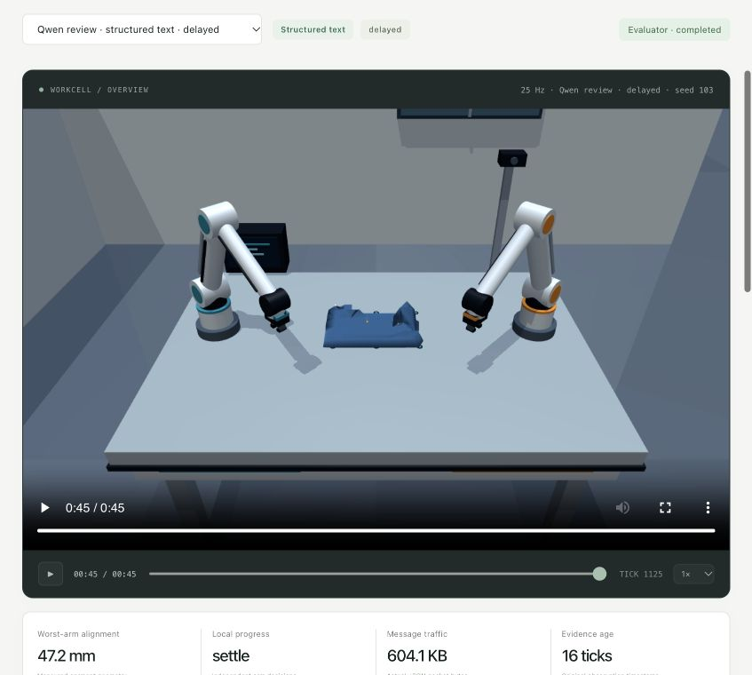

# Two-arm cloth coordination: recorded evidence

Original MuJoCo T-shirt-sheet folding with separate local observations, moving obstacles, delayed/reordered/dropped messages, and actual SpacetimeDB persistence. Every planned attempt is included.

**The complete folds use two distinct small state-assisted neural task controllers.** The separately wired SmolVLA/X-VLA pair performed real inference and robot actions but made no grasps in its short, uncalibrated transfer trial. These results do not establish a foundation-VLA fold.



## Primary matched comparison

Two held-out seeds (101, 102), each in clear and changing-obstacle/delay conditions. Three communication modes, frozen motor weights and codec, identical initial states and camera hashes, identical seeded message schedule, equal 1,800-tick budgets. Qwen is excluded from this controlled suite; the same deterministic phase guards run in every condition.

| Mode | Completed | Mean simulated time | Mean worst-arm hem error | Mean packet size |
| --- | ---: | ---: | ---: | ---: |
| Embeddings | 4/4 | 42.62 s | 5.53 cm | 633 bytes |
| Structured text | 4/4 | 40.36 s | 5.81 cm | 1096 bytes |
| Hybrid | 4/4 | 42.62 s | 5.53 cm | 869 bytes |

See [raw paired results](primary/comparison.json), [post-hoc analysis](primary/analysis.json), and [protocol](primary/protocol.json). The per-mode alignment number averages each episode’s worst arm; it does not average away the weaker arm. Serialized JSON packet sizes include the application envelope and exclude HTTP/SQL readback overhead.

## What worked best here

All three formats completed 4/4 tasks. Structured text was fastest: 40.36 simulated seconds on average, versus 42.62 for embeddings and hybrid. Its mean worst-arm final error was 5.81 cm, versus 5.53 cm for the other modes; it did not win every metric.

Embeddings used 42.2% fewer bytes per packet. Hybrid produced **the same applied actions at every tick and identical final cloth vertices** as embeddings in all four primary conditions, while carrying larger packets. Its exact fields did not change control decisions in this pilot. The independent Qwen seed also produced identical embedding/hybrid outcomes, while text was faster and better aligned there.

Use **structured text as the practical default for this small sensor interface**; it preserves exact geometry and was fastest here. Use the learned bottleneck if packet size matters. There is no observed reason to prefer hybrid in these conditions. These are descriptive observations from a small pilot, not statistical or general superiority claims.

## Qwen and no-communication checks

The separate held-out seed 103 delayed suite uses actual `Qwen/Qwen3-1.7B-MLX-4bit` phase review and SpacetimeDB. It made 32 Qwen calls per episode (96 total); all three modes completed. This suite is not pooled with the primary results.

| Mode | Completed | Simulated time | Worst-arm hem error |
| --- | ---: | ---: | ---: |
| Embeddings | 1/1 | 50.28 s | 8.19 cm |
| Structured text | 1/1 | 45.04 s | 4.71 cm |
| Hybrid | 1/1 | 50.28 s | 8.19 cm |

[Qwen results](qwen/RESULTS.md) retain the model requests and outputs. The two [no-private-communication diagnostics](diagnostics/RESULTS.md) both missed the 9.5 cm hem threshold; one missed by only 5.72 mm. These two failures do not prove communication is universally necessary. The shared vacuum-release interlock remains in every mode.

## Inspect and reproduce

```bash
uv run relay-lab cloth
```

Open http://127.0.0.1:8769. The episode selector includes all 17 scored task-controller runs; the experiment selector keeps the three suites separate. Each run retains its overview and local camera videos, original raw actions, delivered messages, exact model snapshots, final geometry, Qwen output where applicable, and audit. The trace is gzip-compressed without changing its content.

The default Qwen/structured-text overview is a **25 Hz re-execution of the saved actions**. All 1,126 ticks reproduce the recorded robot state exactly, and the final cloth mesh is bitwise identical. This verifies recorded physical execution, not a second neural/LLM run. See [physics verification](physics-replay/verification.json) and [full-resolution recording](physics-replay/overview.mp4). Original sampled videos remain with their episodes.

Every task-controller episode was independently checked against the actual local Spacetime journal. The audit also checks causal delivery, stale/reordered packet rejection, model identity, recorded actions and final geometry. Audits verify consistency; they do not attest an independent neural execution.

See [the experimental protocol and physical assumptions](../../docs/cloth-coordination.md), [released-model trial](pretrained/README.md), and [remaining foundation-model adaptation work](../../checkpoints/cloth-policies/foundation-adaptation.md).

## Limits

This is a small paired pilot with one garment silhouette and one fixture/obstruction schedule. The eight-dimensional PCA channel compresses 23 measured local features; it is not a foundation-model hidden state. The cloth is a single-layer flex sheet with idealized marked-tab clamps and a vacuum fixture released before scoring. Cloth/arm-shell and arm/arm collision are disabled; material constants are uncalibrated. Simulation time pauses for inference and synchronous database requests. Native MuJoCo rendering is not photorealism or real-garment validation.
