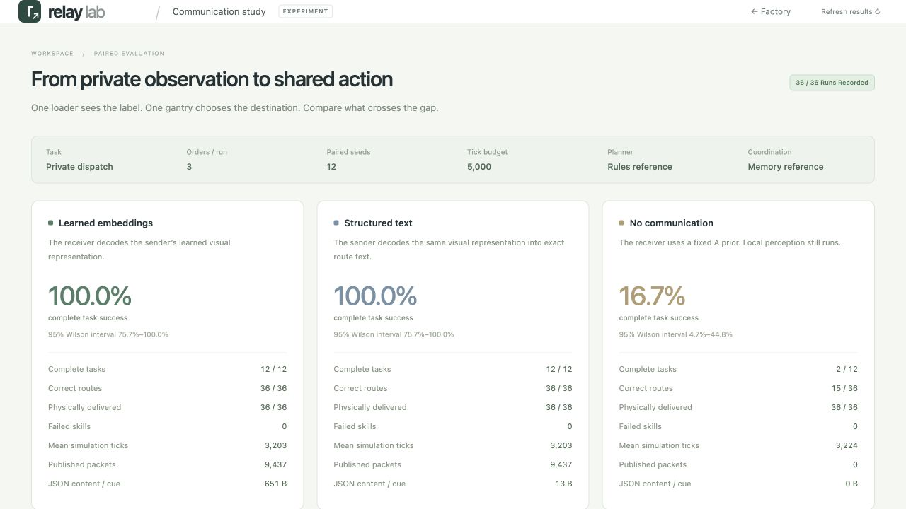

# Factory communication comparison

The private-dispatch task requires the receiving humanoid to pass information
to the dispatch gantry. Only the humanoid sees each part's inspection indicator.
The gantry chooses between two reserved pallet slots. All five robot motor
contexts use the unchanged learned Factory VLA; Qwen and Spacetime remain the
production coordination stack.

## Matched held-out experiment

12 task seeds (101–112), three parts each, identical initial physics and private
camera images across modes, frozen models, and a 5,000-tick budget per run.
The public scheduler is the explicit deterministic reference, with the in-memory
transaction barrier, to isolate the private communication channel.

| Private channel | Full tasks correct | Correct placements | Physically delivered | Failed motor skills |
| --- | ---: | ---: | ---: | ---: |
| Learned 32D embedding | 12 / 12 | 36 / 36 | 36 / 36 | 0 |
| Exact learned text | 12 / 12 | 36 / 36 | 36 / 36 | 0 |
| None; fixed A prior | 2 / 12 | 15 / 36 | 36 / 36 | 0 |



Both communicating modes took the same number of simulation ticks on every
paired task (mean 3,202.5). No communication averaged 3,224 ticks but sorted many
parts incorrectly; physical duration alone is not a useful success metric.
The 95% Wilson task-success intervals are 75.7–100% for each communicating mode
and 4.7–44.8% for no communication. This is a small controlled task, not a broad
robotics benchmark.

The embeddings are useful versus absent information. They do **not** outperform
text here. Both carry the same learned prediction: text decodes it at the sender,
while the vector is decoded at the receiver. Across these runs, unique source
content averaged 650.5 bytes per JSON vector versus 13 bytes per exact text fact.
Including the common metadata and retransmissions, packet writes totaled
11,171,037 versus 5,135,635 bytes. Binary vector serialization or richer visual
tasks could change the tradeoff; they have not been evaluated by this experiment.

## Actual Qwen and Spacetime

The separate integration suite in [results.json](results.json) uses actual local
Qwen and live Spacetime on matched seeds 101–103. Its results are displayed
separately on the comparison page; they are not pooled with the reference suite.

| Channel | Full tasks correct | Correct placements | Physically delivered |
| --- | ---: | ---: | ---: |
| Embeddings | 2 / 3 | 7 / 9 | 7 / 9 |
| Text | 3 / 3 | 9 / 9 | 9 / 9 |
| None | 0 / 3 | 4 / 9 | 9 / 9 |

The seed-103 embedding run stopped at tick 2,339 after an unconfirmed Spacetime
request. Its two unfinished placements remain in the denominator; they are not
silently counted as correct predictions. No motor skill failed, and no
unconfirmed next physical step was executed. The database confirms the terminal
failed state. The precise transient transport cause was not established.

A [single diagnostic repeat](transport-recheck.json) of that exact seed and
condition then completed 3/3 routes in 3,212 ticks. It used the same actor, codec,
private images and budget. It is reported separately and does **not** replace
the failed run in either the table or the dashboard.

Included seed-101 recordings retain all three conditions:

| Condition | Result | Correct routes | Physical deliveries | Ticks |
| --- | --- | ---: | ---: | ---: |
| [Embeddings](qwen-embeddings/summary.json) | Succeeded | 3 / 3 | 3 / 3 | 3,203 |
| [Text](qwen-text/summary.json) | Succeeded | 3 / 3 | 3 / 3 | 3,203 |
| [None](qwen-none/summary.json) | Rejected | 2 / 3 | 3 / 3 | 3,218 |

Each recording folder contains the original complete `events.jsonl.gz`, a
committed-frame `replay.json.gz`, and `summary.json`. The no-communication
recording is deliberately retained as evidence of a correctly reported failed
task. Full traces for all experiment runs remain under the local `runs/`
directories; the repository includes their summaries, hashes and audit results
alongside these three representative complete traces. The interrupted run's
complete evidence is also retained in `qwen-transport-failure/`.

```bash
uv run --extra learned relay-lab factory \
  --replay examples/factory-communication/qwen-embeddings/replay.json.gz \
  --comparison examples/factory-communication/results.json
```

Open <http://127.0.0.1:8767/comparison.html> or
<http://127.0.0.1:8767/?replay=1>. Substitute `qwen-text` or `qwen-none` to inspect
the matched alternative recording. Rejected replays show physical completion
and route mismatch separately.

## Evidence and limitations

- [Protocol](protocol.json) was saved before the held-out matrix ran. Every
  specified seed and mode is counted; no failed condition was omitted.
- [Trace audits](trace-audit.json) check all 36 held-out traces: physical steps,
  all five neural contexts, immutable packet origin, eligible prior committed
  delivery, actual latent decoding, motor slot instructions and measured final
  positions. A successful final snapshot alone is insufficient.
- [Run manifest](run-manifest.json) records SHA-256 hashes and sizes for all 45
  original summaries, full traces and replays.
- [Spacetime audit](spacetime-audit.json) checks all nine original live runs,
  including the interrupted run. The [repeat audit](transport-recheck-audit.json)
  independently verifies its separate successful follow-up.
- [Validation](validation.json) records 480 passing tests, build checks, model
  hashes and the scope of the browser and durable-history checks.
- Learned codec/checkpoint provenance and disjoint held-out image fixtures are
  in [factory-routing](../../checkpoints/factory-routing/README.md). Training uses
  original MuJoCo inspection images, no external demonstration dataset.
- The private cue is a simple immutable two-class inspection signal. The codec
  is a separate visual communication head; it is not a foundation-VLA hidden
  state or an end-to-end motor latent policy.
- Motors use calibrated fiducial images, bounded kinematic actuators and
  proximity-checked attachments. The humanoid does not learn walking or balance.
- Wall timings include local concurrent work. Packet bytes and retrieval
  timings are reported separately; no isolated latency ranking is claimed.

Run a local causal audit, or add `--spacetime` while the original local database
is available to compare every commit against durable history:

```bash
uv run --extra learned python scripts/audit_factory_communication_run.py \
  examples/factory-communication/qwen-embeddings --spacetime
```

See [the implementation and reproduction guide](../../docs/factory-communication.md)
for observation boundaries, channel lifetimes and experiment commands.
