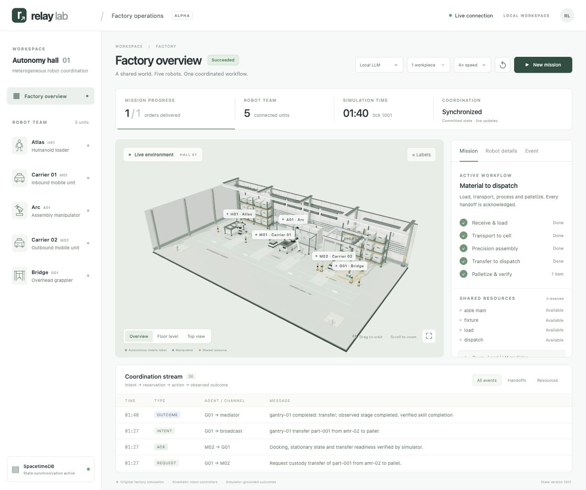
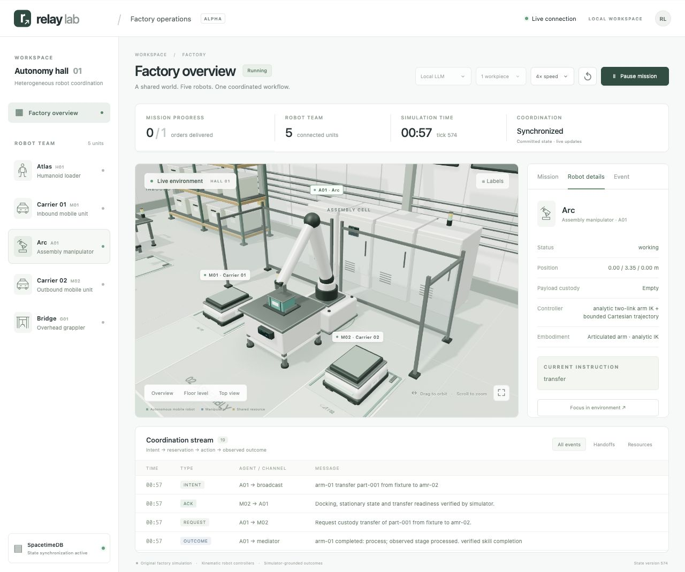

# Verified factory run

The full headless run recorded in `trace.jsonl.gz` used the actual local pinned
Qwen3-1.7B MLX mediator and the real local SpacetimeDB module. It completed **3/3
workpieces**, with **27 completed commands**, **78 messages**, and **zero failed
skills**. Qwen made **27 calls** (no schema repairs), totaling 27.001 seconds of
inference. The run took 2,644 simulation ticks / 264.4 simulated seconds and
93.26 wall-clock seconds on an Apple M3 Pro.

[Validation](validation.json): **284 tests passed**, including the live database suite.

`summary.json` contains the final measured state and model/backend provenance.
The compressed JSONL contains every committed tick, full decision input/output,
messages, cargo ownership, and events. Decompress with `gzip -dc trace.jsonl.gz`.
No account credential or model weights are embedded in these logs.

The screenshots show a separate live browser validation run: one workpiece,
1,001 ticks, nine Qwen decisions, and 26 messages. Pause was tested at tick 47;
resume continued the same mission, and it completed. Robot focus, camera presets,
message inspection, live state updates and error-free browser rendering were
checked on the actual backend.

These are fixed-fixture pilot-factory tests, not randomized benchmark results.
The new embodiments use bounded model-based control with idealized grasp
attachments; they are not trained factory VLAs. See [architecture and physical
limits](../../docs/factory.md). The original tabletop learned-VLA example remains
under [`examples/demo`](../demo/README.md).
